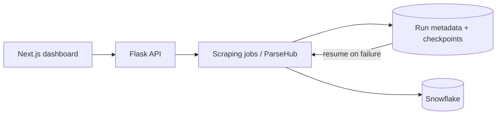

# 🕸️ Enterprise Scraping & Analytics Platform

A full stack platform that automates large-scale data extraction across multiple projects, with a Next.js dashboard, a Flask backend, and Snowflake for storage and analytics.


## Features

- Dashboard to manage scraping projects and runs
- Large-scale extraction across many projects at once
- **Metadata-driven resume system:** every run stores checkpoints, so an interrupted job restarts from where it stopped instead of from the beginning
- Dynamic pagination handling for sites with changing page structures
- Extracted data stored in Snowflake for analytics

## Architecture



## Run locally

```bash
git clone https://github.com/ziauldin/enterprise-scraping-platform.git
cd enterprise-scraping-platform
cp backend/.env.example backend/.env     # add your ParseHub and Snowflake credentials
cp frontend/.env.example frontend/.env
pip install -r backend/requirements.txt
cd frontend && npm install && cd ..
python start.py --backend                # starts the Flask API and the Next.js app
```

Or run everything with Docker: `docker compose up --build`. See [docs/SETUP.md](docs/SETUP.md) for the full environment reference, resume automation, and common issues. Kubernetes manifests are in [infrastructure/](infrastructure/).

## Tech stack

Next.js, React, TypeScript, Flask, Python, Celery, Redis, ParseHub API, Snowflake, Docker, Kubernetes

**Timeline:** early 2026 to April 2026
